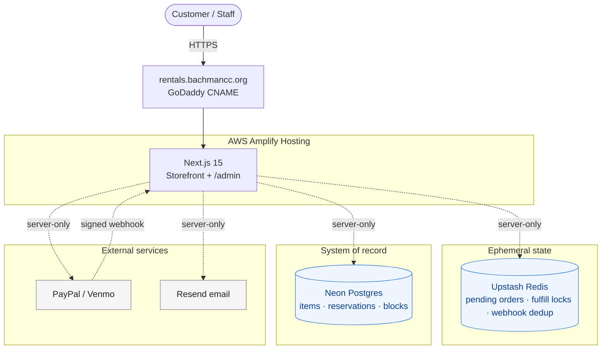

# BCC Rentals — Execution Plan (Plan B)

Living document tracking execution of [ARCHITECTURE_PLAN_B.md](./ARCHITECTURE_PLAN_B.md). Update task statuses as work progresses and commit each change.

**Last updated:** 2026-07-09 · **Progress:** P1.1 ✅ · P1.2 ✅

---

## Architecture summary

Target production stack — all owned in this Next.js repo, no PHP, no Lightsail, no separate booking system. Hard ceiling: **$30/mo** platform spend (excl. per-transaction fees).

| # | Component | Role | Hosting |
| - | --- | --- | --- |
| 1 | **Storefront + `/admin`** (Next.js App Router, pinned to 15) | Public UI, checkout, webhooks, staff admin | AWS Amplify Hosting |
| 2 | **Neon Postgres** | System of record: `items`, `reservations` | Neon serverless (free tier) |
| 3 | **Upstash Redis** | Pending orders (1h TTL), fulfill locks, webhook dedup | Upstash (free tier) |
| 4 | **PayPal** | PayPal + Venmo Smart Buttons (nonprofit rate 1.99% + $0.49) | PayPal-hosted |
| 5 | **Resend** | Customer + staff notification emails | Resend-hosted |
| 6 | **DNS** | `rentals.bachmancc.org` → Amplify (GoDaddy CNAME) | GoDaddy |
| 7 | **Observability** | Amplify logs + pino + Neon dashboard | AWS + Neon |

**Estimated monthly platform spend:** ~$0–3/mo.

### Data & trust flow



- Confirm-then-book invariant preserved: reservations only inserted after payment succeeds.
- Conflict guard = Redis fulfill lock + re-check inside a Postgres transaction.
- Every server module that touches secrets imports `"server-only"`; env Zod-validated at boot.
- Admin: HTTP Basic Auth (V1), Clerk free tier (V2).

### Two inventory models (single schema)

| Type | Example | `total_stock` | Availability check |
| --- | --- | --- | --- |
| Unique resource | Party room, tent | `1` | Any overlapping non-cancelled reservation = unavailable |
| Fungible inventory | Chairs, plates | `N` | `total_stock - SUM(qty reserved during overlap) >= requested_qty` |

### Module layout (target)

```
lib/scheduler/
  client.ts   # getAvailability, createReservation, cancelReservation, getReservation
  db.ts       # Neon client / pool
  policy.ts   # buffer / min length / hours / lead / horizon
  types.ts    # Zod schemas
  errors.ts   # SchedulerError, SchedulerConflictError
app/api/calendar/[itemSlug]/route.ts  # ICS feed
app/admin/…                            # follow-up sprint
```

Detailed schema, SQL queries, LibreBooking→Scheduler method map, and rationale live in [ARCHITECTURE_PLAN_B.md](./ARCHITECTURE_PLAN_B.md).

---

## Priority — do now (Block 1: build scheduler)

Blocks production cutover. Est. ~3 days.

- [x] **P1.1** ✅ Provision Neon Postgres project with two branches: `main` (prod) and `dev` (shared dev/preview). Capture `DATABASE_URL` for each. — Both branches live in `us-east-1` (prod endpoint `ep-rough-shadow`, dev endpoint `ep-cool-field`). Local `.env.local` holds `DATABASE_URL` (prod) + `DATABASE_URL_DEV` (dev); credentials never committed. Follow-up during P1.2/P1.3: standardize pooled (runtime) vs. direct/unpooled (DDL) endpoints across both.
- [x] **P1.2** ✅ Define schema in `lib/scheduler/db/schema.sql` (or Drizzle/Kysely). Tables: `items`, `reservations` + `reservations_item_time_idx`. — Raw SQL + `pg` (no ORM). `items` kept **minimal** (identity + inventory: `slug`, `name`, `type`, `total_stock`, `active`); pricing/policy stay in `lib/products/config.ts` to avoid a lossy dual source of truth. Applied to **both** Neon branches — `dev` via `npm run db:apply` (direct/unpooled `DATABASE_URL_DEV`) and `main` via `npm run db:apply:prod` (`DATABASE_URL`), since `main` is not yet exposed/in use and keeping the branches in sync avoids drift. `DATABASE_URL`/`DATABASE_URL_DEV` added to `lib/env.ts` + README. Pooled-vs-direct: dev DDL uses the direct endpoint; `main`'s DDL currently runs over the pooled endpoint (fine for `CREATE TABLE IF NOT EXISTS`) — standardizing a direct prod endpoint remains the P1.1 follow-up; runtime pooled wiring lands in P1.3.
- [ ] **P1.3** Build `lib/scheduler/client.ts` — 4 methods: `getAvailability`, `createReservation`, `cancelReservation`, `getReservation`. Use `@neondatabase/serverless` or `pg`.
- [ ] **P1.4** Build `lib/scheduler/policy.ts` — validates buffer / min length / available hours / lead time / booking horizon.
- [ ] **P1.5** Build `lib/scheduler/types.ts` — Zod schemas matching existing LibreBooking client surface so call sites change minimally.
- [ ] **P1.6** Unit tests for `lib/scheduler/*` (mock Postgres client; mirror existing `lib/librebooking/*.test.ts` style).
- [ ] **P1.7** Seed initial items in production Neon: tent, popcorn machine, party room. (Chairs / tables / additional items per P4.)

---

## Next

### Block 2 — Swap call sites + ship ICS feed (~1 day)

- [ ] **N2.1** Downgrade Next.js 16 → 15 (Amplify Hosting supports Next 12–15 only).
- [ ] **N2.2** Audit codebase for Amplify-unsupported features: `revalidatePath`, `revalidateTag`, `unstable_after`, `runtime = "edge"`, streaming responses, middleware on optimized images.
- [ ] **N2.3** Swap imports in `app/api/availability/route.ts`, `lib/orders/preflight.ts`, `lib/orders/fulfill.ts` from `lib/librebooking` → `lib/scheduler`.
- [ ] **N2.4** Drop `findOrCreateUser` in `fulfill.ts`; pass customer email/name directly into `createReservation`.
- [ ] **N2.5** Add ICS feed route at `app/api/calendar/[itemSlug]/route.ts` using the `ics` npm package.
- [ ] **N2.6** Add staff notification email to `reservations@bachmancc.org` in `fulfill.ts` (Resend) if not already present.
- [ ] **N2.7** Delete `lib/librebooking/` and all `LIBREBOOKING_*` / `LB_RESOURCE_ID_*` env vars; remove from `lib/env.ts`, `.env.local.example`, README env table.

### Block 3 — Deploy to Amplify (~half day)

- [ ] **N3.1** Create Amplify app from GitHub repo.
- [ ] **N3.2** Port env vars into Amplify Production + Preview environments (add `DATABASE_URL`, drop LibreBooking vars).
- [ ] **N3.3** Add `rentals.bachmancc.org` custom domain in Amplify; cut GoDaddy CNAME (lower TTL first).
- [ ] **N3.4** Register production webhook URLs in the PayPal dashboard against the Amplify HTTPS URL.

### Block 4 — Product & policy decisions (BCC admin, parallelizable with dev)

- [ ] **N4.1** Confirm final rental pricing per item.
- [ ] **N4.2** Confirm party-room hours and slot length.
- [ ] **N4.3** Confirm min lead time and max advance booking window per item.
- [ ] **N4.4** Define fungible inventory (chairs, tables, plates, etc.) with `total_stock` quantities.
- [ ] **N4.5** Verify Resend sending domain `bachmancc.org` (SPF/DKIM records).
- [ ] **N4.6** Finalize cancellation/refund policy text in the confirmation email.

### Block 5 — Production smoke test

- [ ] **N5.1** Availability respects existing reservations.
- [ ] **N5.2** PayPal (sandbox → live) → webhook → reservation written → email arrives → success page renders.
- [ ] **N5.3** Two concurrent browsers on the same slot → second sees clean error + auto-refund.
- [ ] **N5.4** Fungible item: book 50 chairs from stock of 100, verify 50 still available.

### Block 6 — Staff admin UI (follow-up sprint, ~2–3 days)

- [ ] **N6.1** Admin auth: Basic Auth via env-stored password (V1).
- [ ] **N6.2** `/admin/schedule` — FullCalendar grid per item.
- [ ] **N6.3** `/admin/reservations` — filterable list with customer search.
- [ ] **N6.4** `/admin/blocks/new` — form to insert `status='block'` reservation.
- [ ] **N6.5** `/admin/inventory` — per-item stock-vs-reserved chart.

### Block 7 — Operations (post-launch)

- [ ] **N7.1** External uptime monitor (UptimeRobot free tier or equivalent).
- [ ] **N7.2** Runbooks: "customer paid but no confirmation" + "Neon incident" (with optional `pg_dump` to S3 fallback on free tier).
- [ ] **N7.3** Credential rotation cadence for PayPal / Resend / Neon.

---

## Completed

- **P1.1** (2026-07-08) — Neon project provisioned with `main` (prod) + `dev` branches in `us-east-1`; connection strings captured in `.env.local` as `DATABASE_URL` / `DATABASE_URL_DEV`.
- **P1.2** (2026-07-09) — Scheduler schema (`items` minimal + `reservations` + partial index) authored in `lib/scheduler/db/schema.sql` and applied to **both** Neon branches (`dev` via `npm run db:apply`, `main` via `npm run db:apply:prod`; both idempotent, both empty and verified). Overlap query + integrity CHECKs verified in a rolled-back transaction; `DATABASE_URL`/`DATABASE_URL_DEV` registered in `lib/env.ts` + README.

---

## Change log

- **2026-07-08** — Initial plan created from ARCHITECTURE_PLAN_B.md.
- **2026-07-08** — Data & trust flow diagram converted from ASCII to Mermaid.
- **2026-07-08** — Removed Stripe; PayPal (nonprofit rate) is the sole payment processor, matching BCC's existing setup.
- **2026-07-08** — P1.1 complete: Neon `main`/`dev` branches provisioned in `us-east-1`.
- **2026-07-09** — P1.2 complete: scheduler schema defined (raw SQL + `pg`, minimal `items`) and applied to both Neon branches (`dev` + `main`).
