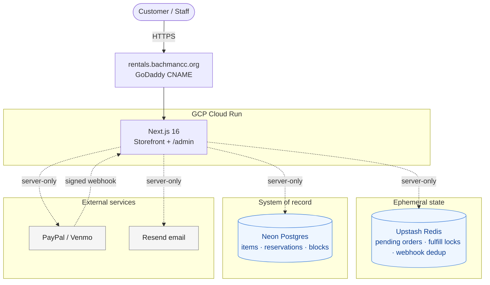

# BCC Rentals — Execution Plan (Plan B)

Living document tracking execution of [ARCHITECTURE_PLAN_B.md](./ARCHITECTURE_PLAN_B.md). Update task statuses as work progresses and commit each change.

**Last updated:** 2026-07-15 · **Progress:** Block 1 ✅ (P1.1–P1.7) · Block 2 ✅ (N2.3–N2.7; N2.1/N2.2 dropped — see hosting note) · Block 3 🚧 (N3.1 ✅ containerized · N3.2 ✅ Cloud Run service live · N3.3 ✅ env vars set; N3.5 = PayPal webhook remaining) · Block D 🚧 demo state (D1 ✅ Stripe removed; D2–D5 open) — **custom-domain mapping + Secret Manager deferred to Block G, post-demo** — **scheduler is the live booking backend; LibreBooking + Stripe removed**

---

## Architecture summary

Target production stack — all owned in this Next.js repo, no PHP, no Lightsail, no separate booking system. Hard ceiling: **$30/mo** platform spend (excl. per-transaction fees).

> **Hosting decision (2026-07-13):** target is **GCP Cloud Run** (containerized, `output: 'standalone'`), not AWS Amplify. Amplify's managed SSR adapter caps at Next.js 15; Cloud Run runs any Next version from a container at ~$0/mo (scale-to-zero). This lets us **stay on Next.js 16** and drops the old N2.1 (Next 16→15 downgrade) and N2.2 (Amplify feature audit) entirely. Neon/Upstash remain in AWS `us-east-1` — deploy Cloud Run to a nearby region.

| # | Component | Role | Hosting |
| - | --- | --- | --- |
| 1 | **Storefront + `/admin`** (Next.js 16 App Router, `output: 'standalone'`) | Public UI, checkout, webhooks, staff admin | GCP Cloud Run |
| 2 | **Neon Postgres** | System of record: `items`, `reservations` | Neon serverless (free tier) |
| 3 | **Upstash Redis** | Pending orders (1h TTL), fulfill locks, webhook dedup | Upstash (free tier) |
| 4 | **PayPal** | PayPal + Venmo Smart Buttons (nonprofit rate 1.99% + $0.49) | PayPal-hosted |
| 5 | **Resend** | Customer + staff notification emails | Resend-hosted |
| 6 | **DNS** | `rentals.bachmancc.org` → Cloud Run (GoDaddy CNAME) | GoDaddy |
| 7 | **Observability** | Cloud Run logs + pino + Neon dashboard | GCP + Neon |

**Estimated monthly platform spend:** ~$0–3/mo.

### Data & trust flow



- Confirm-then-book invariant preserved: reservations only inserted after payment succeeds.
- Conflict guard = Redis fulfill lock + re-check inside a Postgres transaction.
- Every server module that touches secrets imports `"server-only"`; env Zod-validated at boot.
- Admin: HTTP Basic Auth (V1), Clerk free tier (V2).

### Two inventory models (single schema)

| Type | Example | `total_stock` | Availability check |
| --- | --- | --- | --- |
| Unique resource | Party room, tent | `1` | Any overlapping non-cancelled reservation = unavailable |
| Fungible inventory | Chairs, plates | `N` | `total_stock - SUM(qty reserved during overlap) >= requested_qty` |

### Module layout (target)

```
lib/scheduler/
  client.ts   # getAvailability, createReservation, cancelReservation, getReservation
  db.ts       # Neon client / pool
  policy.ts   # buffer / min length / hours / lead / horizon
  types.ts    # Zod schemas
  errors.ts   # SchedulerError, SchedulerConflictError
app/api/calendar/[itemSlug]/route.ts  # ICS feed
app/admin/…                            # follow-up sprint
```

Detailed schema, SQL queries, LibreBooking→Scheduler method map, and rationale live in [ARCHITECTURE_PLAN_B.md](./ARCHITECTURE_PLAN_B.md).

---

## Priority — do now (Block 1: build scheduler)

Blocks production cutover. Est. ~3 days.

- [x] **P1.1** ✅ Provision Neon Postgres project with two branches: `main` (prod) and `dev` (shared dev/preview). Capture `DATABASE_URL` for each. — Both branches live in `us-east-1` (prod endpoint `ep-rough-shadow`, dev endpoint `ep-cool-field`). Local `.env.local` holds `DATABASE_URL` (prod) + `DATABASE_URL_DEV` (dev); credentials never committed. Follow-up during P1.2/P1.3: standardize pooled (runtime) vs. direct/unpooled (DDL) endpoints across both.
- [x] **P1.2** ✅ Define schema in `lib/scheduler/db/schema.sql` (or Drizzle/Kysely). Tables: `items`, `reservations` + `reservations_item_time_idx`. — Raw SQL + `pg` (no ORM). `items` kept **minimal** (identity + inventory: `slug`, `name`, `type`, `total_stock`, `active`); pricing/policy stay in `lib/products/config.ts` to avoid a lossy dual source of truth. **⚠️ Reversed 2026-07-10** (see the "products in DB" Change log entry): the **database is now the source of truth for the full product** — `items` gained content/policy columns, pricing moved to a new `item_prices` table, `config.ts` was replaced by the async `lib/products/repository.ts`, so an admin can add/edit products with no redeploy and pricing can vary by day/time. Applied to **both** Neon branches — `dev` via `npm run db:apply` (direct/unpooled `DATABASE_URL_DEV`) and `main` via `npm run db:apply:prod` (`DATABASE_URL`), since `main` is not yet exposed/in use and keeping the branches in sync avoids drift. `DATABASE_URL`/`DATABASE_URL_DEV` added to `lib/env.ts` + README. Pooled-vs-direct: dev DDL uses the direct endpoint; `main`'s DDL currently runs over the pooled endpoint (fine for `CREATE TABLE IF NOT EXISTS`) — standardizing a direct prod endpoint remains the P1.1 follow-up; runtime pooled wiring lands in P1.3.
- [x] **P1.3** ✅ Build `lib/scheduler/client.ts` — 4 methods: `getAvailability`, `createReservation`, `cancelReservation`, `getReservation`. Use `@neondatabase/serverless` or `pg`. — Uses `pg` (`Pool` + `withTransaction` in `lib/scheduler/db.ts`). `createReservation` re-checks capacity and inserts atomically under a per-item `pg_advisory_xact_lock` (works for both `unique` and `fungible` via `SUM(quantity)` vs `total_stock`); capacity exhaustion → `SchedulerConflictError` (`lib/scheduler/errors.ts`). `referenceNumber` = `reservations.id` (uuid). Verified end-to-end against Neon with a throwaway integration test (booking/overlap/adjacency/cancel-frees, fungible aggregation/exhaustion, unknown-item + bad-window validation) — deleted after run; real mocked units are P1.6.
- [x] **P1.4** ✅ Build `lib/scheduler/policy.ts` — validates lead time / booking horizon / available hours / slot alignment. — Pure module over the DB-sourced `Product` (`import type`, unit-tested). `validateBooking(product, startISO, endISO, now?)` throws a typed `PolicyError` (`code`: `lead-time` | `horizon` | `available-hours` | `slot-alignment`); hourly checks use `Intl.DateTimeFormat` in `America/New_York` (BCC is Eastern; the legacy LibreBooking client's `America/Chicago` is inconsistent and dropped in N2.7). **Length** stays in `quote()` (already runs in preflight); **buffer** is applied in the scheduler overlap: `bufferMinutes` added to both scheduler input schemas and used to widen the `OVERLAP` window in `getAvailability`/`createReservation`. Wiring `validateBooking` + `product.bufferMinutes` into `preflight`/availability is Block 2 (N2.3).
- [x] **P1.5** ✅ Build `lib/scheduler/types.ts` — Zod schemas matching existing LibreBooking client surface so call sites change minimally. — Done alongside P1.3: `lib/scheduler/types.ts` holds Zod input schemas (`getAvailabilityInputSchema`, `createReservationInputSchema`, with `endISO > startISO` refinement) + output types (`Reservation`, `Availability`). Surface is `itemSlug`-based with embedded customer (no `resourceId`/`userId`), per the Plan B method map — call sites still swap in Block 2 (N2.3/N2.4).
- [x] **P1.6** ✅ Unit tests for `lib/scheduler/*` (mock Postgres client). — Added `lib/scheduler/client.test.ts` (4 methods: capacity math, buffer-window widening, advisory-lock→re-check→INSERT ordering, `SchedulerConflictError`/`SchedulerError`, null-on-bad-UUID, row→camelCase mapping) and `lib/products/repository.test.ts` (item/price → `Product` mapping, `baseCents` priority selection, `hourlyConstraints`, 30s cache). Both mock the `getPool`/`withTransaction` seam in `lib/scheduler/db.ts` via `vi.mock` (no real `pg`/env boot) — the repo's first mocked-dependency tests, since no `lib/librebooking/*.test.ts` ever existed; style follows `policy.test.ts`/`pricing.test.ts`. 25 new tests; full suite 43 pass, typecheck clean. No config change needed (existing `server-only` alias suffices).
- [x] **P1.7** ✅ Seed initial items in production Neon: tent, popcorn machine, party room. — `scripts/db/seed-products.mjs` (idempotent upsert by `slug`, replaces each item's price rows) + `npm run db:seed` / `db:seed:prod`. Seeded to **both** branches; values match the pre-migration config (tent $150/day, popcorn $50/day, party-room $40/hr). (Chairs / tables / additional items per N4.4.)

---

## Next

### Block 2 — Swap call sites + ship ICS feed ✅ (2026-07-13)

- [x] ~~**N2.1** Downgrade Next.js 16 → 15~~ **Dropped** — target moved from Amplify to Cloud Run (see hosting note); Next 16 is kept.
- [x] ~~**N2.2** Audit for Amplify-unsupported features~~ **Dropped** — not applicable to Cloud Run (runs the standard Node server).
- [x] **N2.3** ✅ Swapped `app/api/availability/route.ts`, `lib/orders/preflight.ts`, `lib/orders/fulfill.ts` from `lib/librebooking` → `lib/scheduler`. Preflight now checks `scheduler.getAvailability().isAvailable` and enforces `validateBooking` (policy → `PreflightError` 400). Availability route strips customer PII (public endpoint).
- [x] **N2.4** ✅ Dropped `findOrCreateUser`; `fulfill.ts` passes the customer (email/name/phone) directly into `scheduler.createReservation` (quantity 1, `bufferMinutes` from the product); `referenceNumber` = reservation id; catches `SchedulerConflictError` for the refund branch.
- [x] **N2.5** ✅ ICS feed at `app/api/calendar/[itemSlug]/route.ts` via the `ics` package — PII-free events over the item's booking horizon.
- [x] **N2.6** ✅ Staff notification email (`sendStaffNotification` in `lib/email/resend.ts`) sent on fulfill to the new `STAFF_NOTIFICATION_EMAIL` env var.
- [x] **N2.7** ✅ Deleted `lib/librebooking/`; removed `LIBREBOOKING_*` / `LB_RESOURCE_ID_*` from `lib/env.ts`, `.env.local.example`, README env table; dropped the transitional `resourceId` from the `Product` type + repository mapping (DB `resource_id` column left in place, harmless).
- [x] **N2.8** ✅ (added) Full **README overhaul** to match the current stack: rewrote the overview + architecture bullets (Neon = system of record, Redis ephemeral-only, Resend customer+staff email, ICS feed), replaced the LibreBooking BCC-admin prereqs with Neon setup (`db:apply`/`db:seed`), updated the smoke checklist, deployment section (Vercel → Cloud Run), "adding a product" (data-not-code), project layout (`scheduler/` + `calendar/`), and risk areas. No `LibreBooking`/`Vercel`/`Amplify` references remain.

### Block 3 — Containerize + deploy to Cloud Run (~half day)

- [x] **N3.1** ✅ Added `output: 'standalone'` to [next.config.ts](../next.config.ts) + a multi-stage [Dockerfile](../Dockerfile) (Node 22 alpine, non-root `node` user, port 8080) and [.dockerignore](../.dockerignore). Added a `SKIP_ENV_VALIDATION` escape hatch to [lib/env.ts](../lib/env.ts) so `next build` (and CI) runs without real secrets — the runner leaves it unset so runtime env is still Zod-validated at boot; `NEXT_PUBLIC_PAYPAL_CLIENT_ID` is passed as a build `ARG` since it's client-inlined. **Docker isn't installed in this devcontainer**, so verification was done via `next build` (produces `.next/standalone/server.js`) + booting `node server.js` on 8080: `/` (200, DB-backed), `/api/calendar/tent` (200 ICS), `/api/availability` (200 PII-free JSON) all pass; typecheck/lint clean, 43 tests green. The actual `docker build` runs remotely via Cloud Build in N3.2 (`gcloud run deploy --source`). Runbook for N3.2–N3.5: [docs/DEPLOY_CLOUD_RUN.md](./DEPLOY_CLOUD_RUN.md).
- [x] **N3.2** ✅ Created the Cloud Run service `bcc-rentals` (region `us-east1`, min-instances 0, `--allow-unauthenticated`), deployed from source via Cloud Build (`Dockerfile`). Live at `https://bcc-rentals-558348229437.us-east1.run.app` — verified `/` → `200` on 2026-07-15.
- [x] **N3.3** ✅ Set the full `lib/env.ts` var list as Cloud Run service config (`--set-env-vars`): `DATABASE_URL`, `STAFF_NOTIFICATION_EMAIL`, PayPal (`PAYPAL_*`, `NEXT_PUBLIC_PAYPAL_CLIENT_ID`), Resend (`RESEND_API_KEY`, `EMAIL_FROM`), Upstash, and Stripe placeholders; no LibreBooking vars. Service boots (Zod validation passes). **Deferred:** secrets are currently plain env vars, **not** Secret Manager — hardening moved to **Block G / G2** ("Use Secret Manager for high-risk secrets"), per demo-first priority.
- [ ] **N3.5** Register the PayPal webhook URL against the Cloud Run **run.app** HTTPS URL (`.../api/webhooks/paypal`) so payment works in the demo. Re-point to the custom domain in **Block G / G1**.

> **N3.4 (custom domain mapping) moved to Block G / G1** — the front-end must reach demo state (Block D) and get your approval before `rentals.bachmancc.org` is mapped.

### Block D — Demo state 🎯 (next priority; gate before custom domain)

Get the front-end into a demo-ready, approved state on the Cloud Run **run.app** URL **before** mapping `rentals.bachmancc.org` (Block G). "Demo state" = all of:

- [x] **D1 — Stripe removed.** ✅ (2026-07-15) Deleted `app/api/checkout/stripe/route.ts`, `app/api/webhooks/stripe/route.ts`, `lib/payments/stripe.ts`; narrowed the order flow to PayPal-only (`store.ts` `paymentProvider`/`recordWebhookEvent`, `fulfill.ts` `FulfillInput`, `refund.ts`, `preflight.ts` comment). `BookingWidget` lost the Stripe "Pay with card" button (+`startStripe`/`submitting`/unused `Button` import); PayPal funding now enables `card` (guest credit-card path — D2). Dropped `STRIPE_SECRET_KEY`/`STRIPE_WEBHOOK_SECRET`/`NEXT_PUBLIC_STRIPE_PUBLISHABLE_KEY` from `lib/env.ts`; removed `stripe` + `@stripe/stripe-js` deps; scrubbed Stripe prose from README, CLAUDE.md, and DEPLOY_CLOUD_RUN.md. Verified: typecheck 0 errors, lint clean, 43 tests pass, `next build` succeeds (only PayPal routes remain). **Cloud Run cleanup pending redeploy:** the live revision's image still requires `STRIPE_*` at boot, so those service env vars must be dropped **in the same `gcloud run deploy` that ships this Stripe-free image** — removing them standalone would fail the old image's boot.
- [ ] **D2 — Payment works with PayPal or credit card.** PayPal Smart Buttons complete an order end-to-end (PayPal balance **and** card via PayPal's guest card fields) → capture/webhook → reservation written. Requires **N3.5** (PayPal webhook against the run.app URL).
- [ ] **D3 — Emails sent.** Customer receives a confirmation email on successful rental; staff receive a notification on each reservation (`sendStaffNotification` → `STAFF_NOTIFICATION_EMAIL`). Verify both actually deliver from the deployed service. (Sending-domain SPF/DKIM verification is **N4.5**; for the demo, Resend's default/sandbox sender is acceptable.)
- [ ] **D4 — UI navigable + approved.** Storefront listing, `/rentals/[slug]`, booking widget, checkout, and success/error pages are coherent and navigable end-to-end. **Requires David's explicit approval** before this box is checked.
- [ ] **D5 — Admin outlined.** A written outline (not necessarily a built UI) for staff administration: adding/editing products & pricing, and reserving/viewing/blocking time slots. The full build is **Block 6**; D5 only requires the outline so the demo can show the intended admin story. (Interim path today: products via `db:seed` / direct SQL; slots via `status='block'` reservation inserts.)

---

### Block 4 — Product & policy decisions (BCC admin, parallelizable with dev)

- [ ] **N4.1** Confirm final rental pricing per item.
- [ ] **N4.2** Confirm party-room hours and slot length.
- [ ] **N4.3** Confirm min lead time and max advance booking window per item.
- [ ] **N4.4** Define fungible inventory (chairs, tables, plates, etc.) with `total_stock` quantities.
- [ ] **N4.5** Verify Resend sending domain `bachmancc.org` (SPF/DKIM records).
- [ ] **N4.6** Finalize cancellation/refund policy text in the confirmation email.

### Block 5 — Production smoke test

- [ ] **N5.1** Availability respects existing reservations.
- [ ] **N5.2** PayPal (sandbox → live) → webhook → reservation written → email arrives → success page renders.
- [ ] **N5.3** Two concurrent browsers on the same slot → second sees clean error + auto-refund.
- [ ] **N5.4** Fungible item: book 50 chairs from stock of 100, verify 50 still available.

### Block G — Go-live hardening (post-demo; after Block D approval)

Deferred out of Block 3 so the demo can be validated on the run.app URL first.

- [ ] **G1** Map `rentals.bachmancc.org` (Cloud Run domain mapping) and cut the GoDaddy CNAME (lower TTL first). *(Was N3.4 — moved here; demo state must be approved first.)* Then re-point the PayPal webhook (N3.5) from the run.app URL to the custom domain.
- [ ] **G2** Use Secret Manager for high-risk secrets — migrate `DATABASE_URL`, `PAYPAL_CLIENT_SECRET`, `RESEND_API_KEY`, `UPSTASH_REDIS_REST_TOKEN` (and any remaining sensitive vars) from plain Cloud Run env vars to Secret Manager (`--set-secrets`), granting the runtime service account `secretmanager.secretAccessor`. *(Split out of N3.3.)* See [DEPLOY_CLOUD_RUN.md](./DEPLOY_CLOUD_RUN.md) N3.3.

### Block 6 — Staff admin UI (follow-up sprint, ~2–3 days)

- [ ] **N6.1** Admin auth: Basic Auth via env-stored password (V1).
- [ ] **N6.2** `/admin/schedule` — FullCalendar grid per item.
- [ ] **N6.3** `/admin/reservations` — filterable list with customer search.
- [ ] **N6.4** `/admin/blocks/new` — form to insert `status='block'` reservation.
- [ ] **N6.5** `/admin/inventory` — per-item stock-vs-reserved chart.

### Block 7 — Operations (post-launch)

- [ ] **N7.1** External uptime monitor (UptimeRobot free tier or equivalent).
- [ ] **N7.2** Runbooks: "customer paid but no confirmation" + "Neon incident" (with optional `pg_dump` to S3 fallback on free tier).
- [ ] **N7.3** Credential rotation cadence for PayPal / Resend / Neon.

---

## Completed

- **P1.1** (2026-07-08) — Neon project provisioned with `main` (prod) + `dev` branches in `us-east-1`; connection strings captured in `.env.local` as `DATABASE_URL` / `DATABASE_URL_DEV`.
- **P1.2** (2026-07-09) — Scheduler schema (`items` minimal + `reservations` + partial index) authored in `lib/scheduler/db/schema.sql` and applied to **both** Neon branches (`dev` via `npm run db:apply`, `main` via `npm run db:apply:prod`; both idempotent, both empty and verified). Overlap query + integrity CHECKs verified in a rolled-back transaction; `DATABASE_URL`/`DATABASE_URL_DEV` registered in `lib/env.ts` + README.
- **P1.3 + P1.5** (2026-07-09) — Scheduler client (`lib/scheduler/{client,db,types,errors}.ts`) built on `pg` with an advisory-lock transaction for race-safe booking; 4 methods verified end-to-end against Neon. `pg`/`@types/pg` added; `vitest.config.ts` aliases `server-only` for tests.
- **P1.6** (2026-07-13) — Unit tests for the DB-backed data layer: `lib/scheduler/client.test.ts` (all 4 scheduler methods) + `lib/products/repository.test.ts` (item/price→`Product` mapping + cache), both mocking the `lib/scheduler/db.ts` seam via `vi.mock`. 25 new tests; full suite 43 pass; typecheck clean. **Block 1 (build scheduler) complete** — next up is Block 2 (swap call sites + ICS feed).
- **Block 2 — scheduler swap + ICS + staff email** (2026-07-13) — Cut the live order flow from LibreBooking to `lib/scheduler` (N2.3/N2.4): `preflight` checks `getAvailability().isAvailable` + enforces `validateBooking`; `fulfill` calls `scheduler.createReservation` with the embedded customer and catches `SchedulerConflictError`; the availability API returns PII-free windows. Added the ICS feed (N2.5) and staff notification email + `STAFF_NOTIFICATION_EMAIL` (N2.6). Deleted `lib/librebooking/` and all `LIBREBOOKING_*`/`LB_RESOURCE_ID_*` vars; dropped `resourceId` from the product type/repository (N2.7). Full README overhaul to the current stack (N2.8). **Hosting target changed Amplify → GCP Cloud Run**, so N2.1 (Next 16→15 downgrade) and N2.2 (Amplify audit) were dropped and Next 16 is kept; Block 3 is now containerize + Cloud Run. Verified: typecheck clean, 43 tests pass, `next build` succeeds, and the `/api/availability` + `/api/calendar/[itemSlug]` endpoints return PII-free JSON / valid ICS at runtime.
- **Products in DB + P1.4 + P1.7** (2026-07-10) — Reversed the P1.2 "config is source of truth" decision: the **database now owns the full product**. `items` expanded (content, policy, `available_hours` jsonb, transitional `resource_id`) + new `item_prices` table (day/time-scoped rows; flat now, variable-pricing-ready). `lib/products/config.ts` replaced by client-safe `lib/products/types.ts` + async `lib/products/repository.ts` (DB→`Product` mapper, 30s per-instance cache); the 6 `getProduct`/`ALL_PRODUCTS` call sites now `await`. `quote()` resolves the rate from price rows (`resolveRate`). `lib/scheduler/policy.ts` (P1.4) + buffer plumbing added. Seed script + `db:seed`/`db:seed:prod` seeded both Neon branches (P1.7). Typecheck clean (only pre-existing BookingWidget errors remain), 18 tests pass, storefront verified rendering products from the DB.

---

## Change log

- **2026-07-08** — Initial plan created from ARCHITECTURE_PLAN_B.md.
- **2026-07-08** — Data & trust flow diagram converted from ASCII to Mermaid.
- **2026-07-08** — Removed Stripe; PayPal (nonprofit rate) is the sole payment processor, matching BCC's existing setup.
- **2026-07-08** — P1.1 complete: Neon `main`/`dev` branches provisioned in `us-east-1`.
- **2026-07-09** — P1.2 complete: scheduler schema defined (raw SQL + `pg`, minimal `items`) and applied to both Neon branches (`dev` + `main`).
- **2026-07-09** — P1.3 + P1.5 complete: `lib/scheduler/` client (`getAvailability`/`createReservation`/`cancelReservation`/`getReservation`) on `pg` with advisory-lock booking, plus Zod types; verified against Neon.
- **2026-07-10** — Products moved into Postgres (reverses the P1.2 minimal-`items` decision): DB is source of truth for the full product; `items` expanded + new `item_prices` table (variable-pricing-ready). P1.4 (`lib/scheduler/policy.ts` + buffer plumbing) and P1.7 (seed script, both branches seeded) complete.
- **2026-07-13** — P1.6 complete: mocked-`pg` unit tests for `lib/scheduler/client.ts` + `lib/products/repository.ts` (25 tests; suite 43 pass). Block 1 done.
- **2026-07-13** — Hosting target changed **AWS Amplify → GCP Cloud Run** (Amplify caps at Next 15; Cloud Run runs Next 16 in a container at ~$0/mo). N2.1 (downgrade) + N2.2 (Amplify audit) dropped.
- **2026-07-13** — Block 2 complete: order flow booked against `lib/scheduler` instead of LibreBooking; LibreBooking module + env vars deleted; ICS feed + staff notification email added.
- **2026-07-14** — README overhauled to the current stack (Neon + Cloud Run); all LibreBooking/Vercel/Amplify prose removed. Architecture table DNS/observability rows corrected to Cloud Run/GCP.
- **2026-07-15** — **D1 complete: Stripe removed.** Deleted the Stripe checkout/webhook routes + `lib/payments/stripe.ts`, narrowed the order flow + `refund`/`store`/`fulfill` to PayPal-only, switched `BookingWidget` to PayPal card funding (covers D2's credit-card path), dropped the `STRIPE_*` env vars and `stripe`/`@stripe/stripe-js` deps, and scrubbed Stripe from README/CLAUDE.md/DEPLOY_CLOUD_RUN.md. Typecheck/lint/43 tests/`next build` all green. Cloud Run `STRIPE_*` vars to be dropped in the next redeploy (old image still requires them at boot).
- **2026-07-15** — N3.2 + N3.3 complete: Cloud Run service `bcc-rentals` deployed to `us-east1` from source (live at `bcc-rentals-558348229437.us-east1.run.app`, `/` → 200); all `lib/env.ts` vars set as service config. **Reprioritized to demo-first:** added **Block D** (demo state gate — Stripe removal, PayPal/card payment, customer+staff emails, approved navigable UI, admin outline). **Moved** custom-domain mapping (was N3.4) and Secret Manager hardening (split out of N3.3) into the new post-demo **Block G** — `rentals.bachmancc.org` is not mapped until the demo is approved.
- **2026-07-14** — N3.1 complete: repo containerized (`output: 'standalone'` + multi-stage `Dockerfile` + `.dockerignore`); `SKIP_ENV_VALIDATION` added to `lib/env.ts` for secret-free builds. Standalone server verified booting on 8080 (storefront/ICS/availability all 200). Added `docs/DEPLOY_CLOUD_RUN.md` runbook for the user-run infra steps N3.2–N3.5.
